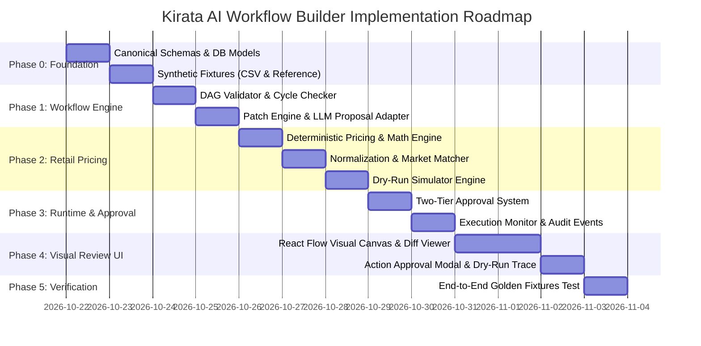

# IMPLEMENTATION PLAN — KIRATA AI WORKFLOW BUILDER (v2.0)
**Project Evolution**: JuraganAI F&B Agent → Configurable Business Automation Platform  
**Initial Vertical**: Used-iPhone Retail Pricing & Catalog Automation  
**Core Philosophy**: AI-first • Visual-review-first • Human-approved  
**Date**: 22 October 2026 | **Status**: Architecture & Implementation Baseline  

---

## 1. Executive Summary & Paradigm Shift

Kirata AI Workflow Builder merevolusi arsitektur agen dari skrip agen tunggal yang *hardcoded* (sebelumnya F&B marketing) menjadi **Platform Otomasi Bisnis Berbasis Template**.

```
[ Traditional Agentic Approach ]
User Prompt ──> LLM ──> Arbitrary Code Execution (High Risk, Hallucination, Unauditable) ❌

[ Kirata v2.0 Architecture ]
User Prompt ──> LLM ──> Typed JSON Graph Patch ──> Deterministic Validator (DAG/Schema)
                                                               │
                                                               ▼
Live Execution Engine ◄── Human Activation ◄── Dry-Run & Visual Diff (React Flow)
(Pinned Immutable JSON)      (Two-Tier Approval)
```

### Prinsip Utama Kirata:
1. **Canonical Workflow Definition (JSON/Pydantic)**: Single source of truth. Schema ini yang dipakai untuk me-render visual graph (React Flow) DAN di-compile menjadi *execution graph* (LangGraph / Deterministic Pipeline).
2. **AI Never Emits Code**: LLM hanya menghasilkan *Typed Patch Operations* (misal: `UPDATE_NODE_CONFIG`, `INSERT_NODE`, `REMOVE_EDGE`) terhadap allowlist node/tool resmi.
3. **Two-Tier Human Approval**:
   - *Tier 1: Configuration Approval* (Persetujuan aktivasi versi immutable workflow setelah melihat visual diff & dry-run).
   - *Tier 2: Business Action Approval* (Persetujuan mutasi bisnis nyata, contoh: ekspor katalog / update harga).
4. **Deterministic Pricing Engine**: Perhitungan margin, markup, dan batas deviasi pasar dihitung secara matematis pasti (zero hallucination).

---

## 2. Codebase Delta & Migration Matrix

Berikut adalah pemetaan mendalam atas apa yang berubah di dalam codebase `f:\AI-AGENT`:

| Komponen / Modul | Status | Analisis & Rencana Aksi |
| :--- | :--- | :--- |
| **`app/services/deepseek_agent.py`** | **Dipertahankan & Disesuaikan** | Adapter multi-provider (AtmoRouter `atmo/deepseek-v4.1-flash` & DeepSeek Official) tetap digunakan sebagai AI engine untuk menerjemahkan Natural Language menjadi *Typed Patch Operations*. Prompt diubah dari F&B menjadi Workflow Patch Generator. |
| **`app/bot/telegram_bot.py`** | **Dipertahankan & Diintegrasikan** | Diarahkan untuk melayani **Action-Level Approval** (Tier 2) & notifikasi run failure/pending approval langsung ke ponsel owner. |
| **F&B Services (`analytics_engine`, `opportunity_detector`, `campaign_planner`, dll.)** | **Dipisahkan / Dialihkan ke Template** | Kode F&B tidak dibuang, melainkan dipindahkan ke `app/templates/fnb_marketing/` sebagai template masa depan platform Kirata (sesuai FR-16). |
| **`app/schemas/workflow.py`** | **BARU (P0)** | Pydantic schema Canonical Workflow (`WorkflowDefinition`, `Node`, `Edge`, `PatchOperation`, `WorkflowProposal`, `DryRunResult`). |
| **`app/services/workflow_validator.py`** | **BARU (P0)** | Validasi server-side DAG: deteksi cycle, reachability, allowlisted tools, type compatibility antara input/output node. |
| **`app/services/patch_engine.py`** | **BARU (P0)** | Menerapkan typed patch LLM ke base workflow definition, menghasilkan versi draft baru serta komparasi *diff* (added/modified/deleted nodes & edges). |
| **`app/services/workflow_compiler.py`** | **BARU (P0)** | Meng-compile Canonical Workflow Definition menjadi pipeline eksekusi berbasis event log dengan state persistence. |
| **`app/services/retail_pricing/`** | **BARU (P0)** | Domain engine Used-iPhone: <br>1. `vendor_normalizer.py` (Normalisasi CSV model, storage, grade, sinyal/distribusi inter vs iBox).<br>2. `market_matcher.py` (Lookup referensi pasar dengan confidence & timestamp).<br>3. `margin_calculator.py` (Formula margin $m = \frac{p-c}{p}$, minimum price $\frac{c}{1-m}$, pembulatan).<br>4. `review_flagger.py` (Menandai `NEEDS_REVIEW`, `ABOVE_MARKET`, baterai rendah, anomali). |
| **`app/models/workflow.py`** | **BARU (P0)** | Tabel database: `tenants`, `workflows`, `workflow_versions`, `workflow_proposals`, `workflow_runs`, `node_run_events`, `action_approvals`, `vendor_imports`. |
| **Visual UI (React Flow + Dashboard)** | **BARU (P0)** | Canvas visualisasi graph, diff visual (warna hijau/kuning/merah), panel chat instruksi, tombol dry-run, dan modal approval. |

---

## 3. Spesifikasi Kontrak Data Canonical (The Single Source of Truth)

### 3.1 Canonical Workflow Definition JSON
```json
{
  "id": "wf_retail_pricing_001",
  "tenant_id": "tenant_juragan_cell",
  "template_id": "tpl_used_iphone_pricing_v1",
  "version": 1,
  "status": "ACTIVE",
  "name": "Used iPhone Pricing & Margin Automation",
  "nodes": [
    {
      "id": "upload_vendor_list",
      "tool_type": "retail.upload_vendor_list",
      "tool_version": "1.0.0",
      "config": { "allowed_formats": ["csv"] },
      "input_bindings": {},
      "output_schema": "VendorRawList"
    },
    {
      "id": "extract_and_normalize",
      "tool_type": "retail.extract_and_normalize",
      "tool_version": "1.0.0",
      "config": { "default_currency": "IDR", "strict_storage": true },
      "input_bindings": { "raw_data": "upload_vendor_list.output" },
      "output_schema": "NormalizedProductBatch"
    },
    {
      "id": "validate_attributes",
      "tool_type": "retail.validate_attributes",
      "tool_version": "1.0.0",
      "config": { "required_fields": ["model", "storage_gb", "cost", "unit_condition"] },
      "input_bindings": { "items": "extract_and_normalize.output" },
      "output_schema": "ValidatedProductBatch"
    },
    {
      "id": "match_market_references",
      "tool_type": "retail.match_market_references",
      "tool_version": "1.0.0",
      "config": { "max_data_age_days": 14, "allow_cross_distribution": false },
      "input_bindings": { "items": "validate_attributes.output" },
      "output_schema": "PricedReferenceBatch"
    },
    {
      "id": "calculate_pricing",
      "tool_type": "retail.calculate_pricing",
      "tool_version": "1.0.0",
      "config": {
        "target_gross_margin": 0.15,
        "overhead_fee": 50000,
        "rounding_increment": 50000
      },
      "input_bindings": { "items": "match_market_references.output" },
      "output_schema": "CalculatedCatalogBatch"
    },
    {
      "id": "compare_to_market",
      "tool_type": "retail.compare_to_market",
      "tool_version": "1.0.0",
      "config": { "max_premium_percent": 0.05 },
      "input_bindings": { "items": "calculate_pricing.output" },
      "output_schema": "MarketComparisonBatch"
    },
    {
      "id": "conditional_review_flag",
      "tool_type": "retail.conditional_review_flag",
      "tool_version": "1.0.0",
      "config": { "flag_stale_reference": true, "flag_low_battery_under": 80 },
      "input_bindings": { "items": "compare_to_market.output" },
      "output_schema": "ReviewedCatalogBatch"
    },
    {
      "id": "owner_action_approval",
      "tool_type": "governance.action_approval",
      "tool_version": "1.0.0",
      "config": { "action_type": "CATALOG_PUBLISH_OR_EXPORT", "require_preview": true },
      "input_bindings": { "catalog": "conditional_review_flag.output" },
      "output_schema": "ApprovedCatalogPayload"
    },
    {
      "id": "export_catalog",
      "tool_type": "retail.export_catalog",
      "tool_version": "1.0.0",
      "config": { "export_format": "csv" },
      "input_bindings": { "payload": "owner_action_approval.output" },
      "output_schema": "ExportResult"
    }
  ],
  "edges": [
    { "source": "upload_vendor_list", "target": "extract_and_normalize" },
    { "source": "extract_and_normalize", "target": "validate_attributes" },
    { "source": "validate_attributes", "target": "match_market_references" },
    { "source": "match_market_references", "target": "calculate_pricing" },
    { "source": "calculate_pricing", "target": "compare_to_market" },
    { "source": "compare_to_market", "target": "conditional_review_flag" },
    { "source": "conditional_review_flag", "target": "owner_action_approval" },
    { "source": "owner_action_approval", "target": "export_catalog" }
  ],
  "permissions": ["retail:read_vendor", "market:read_reference", "catalog:export"],
  "approval_policy": {
    "require_config_activation_approval": true,
    "require_action_approval": true
  }
}
```

### 3.2 Typed Patch Schema (Output dari DeepSeek)
Ketika owner memberi instruksi: *"Tolong naikkan target gross margin jadi 18% dan tambahkan biaya overhead packing Rp75.000"*:
```json
{
  "base_version": 1,
  "rationale": "Menaikkan target margin menjadi 18% dan overhead packing Rp75.000 pada node kalkulasi harga sesuai instruksi owner.",
  "risk_level": "LOW",
  "patch_operations": [
    {
      "op": "UPDATE_NODE_CONFIG",
      "node_id": "calculate_pricing",
      "config_patch": {
        "target_gross_margin": 0.18,
        "overhead_fee": 75000
      }
    }
  ],
  "requires_clarification": false,
  "clarification_message": null
}
```

---

## 4. Phased Implementation Roadmap



### **Fase 0 — Foundation & Contract Baseline**
- Buat model data Pydantic di `app/schemas/workflow.py`.
- Buat tabel SQLAlchemy di `app/models/workflow.py`.
- Siapkan dataset sintetis Used-iPhone di `data/fixtures/`:
  - `vendor_raw_samples.csv` (30 baris: variasi nama singkatan, iPhone 11-15, baterai < 80%, inter vs iBox, harga corrupt).
  - `market_references.json` (50 record harga pasar referensi wajar + kasus referensi usang/stale).
- **Exit Gate**: Schema dapat serialize/deserialize 100% dan fixture siap uji.

### **Fase 1 — Workflow Builder & Typed Patch Validator**
- Implementasikan `app/services/workflow_validator.py`:
  - Validasi DAG (Directed Acyclic Graph) via Kahn's algorithm atau NetworkX.
  - Memastikan seluruh node types dan tool types berada di dalam *allowlist*.
  - Verifikasi schema kesesuaian input/output bindings.
- Implementasikan `app/services/patch_engine.py`:
  - Menerapkan `UPDATE_NODE_CONFIG`, `INSERT_NODE`, `REMOVE_NODE`, `ADD_EDGE`, `REMOVE_EDGE`.
  - Memproduksi visual diff metadata (status node: `UNCHANGED`, `MODIFIED`, `ADDED`, `REMOVED`).
- Integrasikan dengan `app/services/deepseek_agent.py` dengan prompt terstruktur *JSON mode* (AtmoRouter DeepSeek v4.1 Flash).
- **Exit Gate**: 20 variasi prompt konfigurasi natural language berhasil menghasilkan valid patch tanpa error sintaks.

### **Fase 2 — Retail Pricing Runtime Engine (iPhone Vertical)**
- Implementasikan formula matematis ketat di `app/services/retail_pricing/`:
  $$\text{Selling Price} = \text{RoundUp}\left( \frac{\text{Total Cost}}{1 - m}, \text{increment} \right)$$
  $$\text{Total Cost} = \text{Vendor Cost} + \text{Overhead Fee}$$
- Guardrails:
  - Validasi perbedaan mutlak Margin vs Markup.
  - Jika `market_reference` < `Selling Price` $\rightarrow$ set status `NEEDS_REVIEW` (bukan menurunkan harga secara sepihak di bawah margin target!).
  - Unit tanpa baterai / baterai < 80% / garansi tidak jelas $\rightarrow$ flagged `LOW_BATTERY` atau `NEEDS_REVIEW`.
- Buat engine `dry_run`: menjalankan eksekusi sampel 100% di memory tanpa persistensi atau side-effect.
- **Exit Gate**: Unit test deterministic pricing lulus 100% pada semua kasus batas.

### **Fase 3 — Persistence, Runtime Execution, & Two-Tier Approval**
- Implementasikan API endpoints:
  - `POST /api/v1/workflows/from-template`
  - `POST /api/v1/workflows/{id}/proposals` (Chat LLM patch proposal)
  - `POST /api/v1/workflows/{id}/dry-run` (Menjalankan simulasi fixture)
  - `POST /api/v1/workflows/{id}/approve` (Tier 1: Configuration approval & aktivasi)
  - `POST /api/v1/workflows/{id}/runs` (Menjalankan run dengan data CSV vendor upload)
  - `POST /api/v1/runs/{id}/actions/{action_id}/decision` (Tier 2: Approve/Reject katalog publikasi)
- Event logging per node (`node_run_events`) untuk auditabilitas penuh.
- **Exit Gate**: Workflow berstatus DRAFT tidak dapat dieksekusi; Run berhenti menunggu persetujuan pada node `owner_action_approval`.

### **Fase 4 — Visual Review Canvas & Web Dashboard**
- Bangun UI interaktif (atau modern vanilla component dengan React Flow / Canvas visualization):
  - Canvas Node Graph dengan badge visual: *Hijau (Added)*, *Kuning (Modified)*, *Abu-abu (Unchanged)*.
  - Chat Panel di sisi kiri untuk percakapan revisi alur kerja.
  - Change Summary & Diff Panel yang menjelaskan secara transparan perubahan parameter dan risikonya.
  - Dry-Run Inspector: melihat input/output trace per node sebelum aktivasi.
  - Action Approval Dashboard: preview tabel harga yang diusulkan sebelum diunduh/diekspor.
- **Exit Gate**: Reviewer dapat memahami perubahan alur kerja hanya dalam 5 detik melalui grafik visual.

### **Fase 5 — Pilot Readiness, End-to-End Scenarios, & Documentation**
- Jalankan skenario acceptance test lengkap (dari PRD Tabel 14):
  1. Ubah margin 12% → 15%.
  2. Tambahkan rule garansi.
  3. Instruksi tool yang tidak didukung (harus ditolak dengan klarifikasi sopan, tanpa halusinasi).
  4. CSV vendor dengan baris kotor / format corrupt.
  5. Kasus harga referensi pasar usang / tidak ditemukan.
- Dokumentasikan laporan final progress di `docs/progress/`.

---

## 5. Pertimbangan Keamanan & Keandalan (Safety Guardrails)

1. **Zero Unapproved Mutations**: Sistem tidak akan pernah mengekspor atau mempublikasikan harga baru tanpa approval eksplisit (0 unapproved mutations).
2. **Immutable Versioning**: Setiap workflow yang aktif bersifat *read-only*. Setiap perubahan melalui instruksi chat selalu membentuk *draft proposal* baru dengan nomor versi bertahap (v1, v2, v3).
3. **Prompt Injection Boundary**: Data CSV vendor dan referensi eksternal dianggap sebagai *untrusted input*. LLM tidak mengeksekusi kode dari teks file vendor.
4. **Tenant Isolation**: Setiap alur kerja, run, dan katalog terisolasi berdasarkan `tenant_id`.
