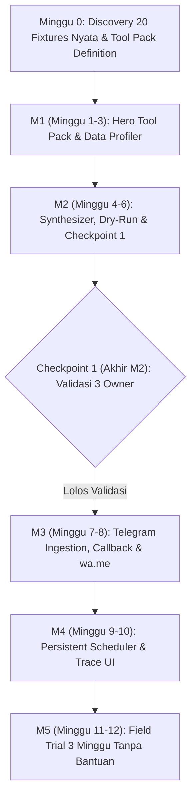

# PRD: Kirata Problem-to-Workflow Synthesizer & Execution Engine (v3.4)

> **Document Status:** PROPOSED (Approved as Baseline for Week 0 Discovery)  
> **Date:** November 2026  
> **Target Release:** Q1-Q2 2027 (10–12 Weeks Scope)  
> **Produk Inti:** Engine general "masalah user → AI merakit workflow → dry-run → ACC", tidak terikat domain.  
> **Pack Uji Tahap 1:** Engine dibuktikan dengan 2 tool pack dari domain berbeda: **Pack Inventori** (restock & draf PO, data nyata dari Week 0) dan **Pack Marketing** (promo & flyer, sudah ada). Domain lain menyusul sebagai pack tambahan, tanpa mengubah engine.

> [!IMPORTANT]
> **Revisi v3.4 (5 Nov 2026):** Restock bukan produknya, melainkan pack uji pertama. Kriteria lulus engine: synthesizer mampu merakit workflow yang benar di **dua domain berbeda** dari registry yang sama, tanpa kode khusus per template di engine.

---

## 1. Executive Summary & Problem Re-alignment

### 1.1 Root Problem
UMKM di Indonesia (F&B, mini-market, retail) membuang 2–4 jam setiap minggu untuk mengecek stok manual di Excel/buku catatan, menghitung safety stock, dan mengetik ulang pesanan supplier ke WhatsApp.
Otomasi yang ada (Zapier, n8n) gagal karena:
1. Format Excel UMKM sangat berantakan: cell ter-merge, teks mata uang `Rp 15.000` / `15.000,50`, kolom tidak konsisten, header tidak selalu di baris 1.
2. Kolom ambigu (`Sisa`, `Keluar`, `Ket`) yang jika ditebak sembarangan oleh AI berisiko fatal terhadap cashflow dan stok.
3. Otomasi WhatsApp tidak resmi berisiko tinggi pemblokiran nomor bisnis permanen.

### 1.2 Our Solution
**Kirata** adalah mesin operasi hybrid (kombinasi *deterministic profiler* dan *design-time agentic loop*) yang:
- Mengubah keluhan bisnis / file Excel nyata menjadi workflow terverifikasi.
- Menjalankan **read-only dry-run** pada data riil sebelum meminta persetujuan owner.
- Memproses eksekusi mingguan lewat Telegram Bot secara aman, memvalidasi persetujuan pemilik, dan menyiapkan tautan `wa.me/` legal tanpa risiko ban.

---

## 2. Non-Goals (Batasan Eksplisit)

Menghindari scope-creep dan menjaga kejelasan batas produk:
1. **Bukan Pengganti POS / Kasir Multi-User**: Kirata bukan software POS kasir toko atau multi-terminal checkout.
2. **Bukan Pengirim WhatsApp Otomatis Tanpa Manusia**: Tidak ada bot background yang mengirim pesan langsung ke supplier via protokol scraping/reverse-engineered. Semua pesan berstatus *"Draf diserahkan ke owner"* via tautan `wa.me/` atau salin teks.
3. **Tidak Mendukung Rollback Aksi Eksternal**: Aksi eksternal yang sudah disetujui (misal webhook pihak ketiga atau pesan yang sudah dikirim manual oleh owner) tidak dapat di-rollback otomatis secara komputasi.
4. **Tidak Menambah Fitur Image Generation Baru**: Pack Marketing dipakai apa adanya sebagai pack uji kedua. Peningkatan kualitas flyer/image-gen tidak dikerjakan di tahap ini.
5. **Tidak Ada Kode Khusus Template di Engine**: Runner, validator, dan synthesizer tidak boleh memuat percabangan `if template_id == ...` atau `if tool_type == ...`. Perilaku khusus domain hidup di tool pack.

---

## 3. End-to-End Architecture & Core Components

```
[Onboarding & Setup Tenant]
  - Registrasi Tenant ID + Binding Owner Telegram Chat ID
  - Ingest Master Supplier & Inisialisasi Tabel Alias (Nama toko -> ID Supplier)
                            │
                            ▼
[Week 0 Discovery & Baseline Eval Fixtures]
  - Koleksi 20 file nyata UMKM (12 Dev Fixtures, 8 Held-out Test Fixtures)
  - 30 Prompt berlabel (termasuk Out-Of-Domain prompts yang wajib ditolak)
                            │
                            ▼
[Design-Time Synthesis & Data Profiling]
  User Curhat / Problem Prompt + Drop Sample Excel/CSV
                            │
                            ▼
               ┌─────────────────────────┐
               │ 1. Zero-Value Egress    │  <-- HANYA kirim nama kolom, tipe inferensi,
               │    Local PII Boundary   │      dan metadata statistik. Nilai baris/PII
               └────────────┬────────────┘      (NIK, HP, Rekening, NPWP) 0% dikirim ke LLM.
                            │
                            ▼
               ┌─────────────────────────┐
               │ 2. Data Profiler Engine │  <-- Deteksi baris header sejati, unmerge cells,
               └────────────┬────────────┘      normalisasi Rp, hitung null & rasio nilai.
                            │
                            ▼
               ┌─────────────────────────┐
               │ 3. Column Mapper        │  <-- rapidfuzz + LLM fallback.
               │    + Explicit Guard     │      *Mapping PERTAMA per tenant wajib konfirmasi.*
               └────────────┬────────────┘      *Kolom kritis (harga/stok) TIDAK BOLEH auto-ACC.*
                            │                   Tampilkan nilai sampel: "Sisa berisi [12, 0, 5]?"
                            ▼
               ┌─────────────────────────┐
               │ 4. Synthesizer Loop     │  <-- Rancang DAG dari 5-8 Built-in Restock Tools.
               │    (Evaluator-Optimizer)│      Validasi: Acyclic, Port Schema, Invariant Gate.
               └────────────┬────────────┘      *Bisa tolak jujur jika di luar domain tools.*
                            │
                            ▼
               ┌─────────────────────────┐
               │ 5. Read-Only Dry Run    │  <-- Eksekusi file asli dengan flag dry_run=True.
               │    & Semantics Check    │      Sanity check: Filter menghasilkan 0 baris / 100%?
               └────────────┬────────────┘      Tampilkan Kartu Proposal di UI/Chat.
                            │
                            ├── Revisi chat interaktif oleh User
                            ▼
                     [User Meng-ACC DAG]
                            │
                            ▼
               ┌─────────────────────────┐
               │ 6. Simpan Schema Sig    │  <-- Hash(sorted normalized header names saja).
               │    & Workflow Spec      │      Kebal false-drift sel kosong.
               └────────────┬────────────┘
                            │
                            ▼
[Runtime Execution Engine (NodeExecutor Interface)]
  Drop File via Telegram / Pengingat Cron 08:00 WIB
                            │
                            ▼
  Deteksi Drift: Header Kritis Hilang -> Pause & Alert
  Eksekusi Tool Deterministic -> Tier EXTERNAL / FINANCIAL
                            │
                            ▼
  Simpan Approval DB (UUID pendek) -> Telegram Inline Callback (< 32 byte)
  Validasi: effective_user_id == owner_telegram_id + Token aktif
                            │
                            ▼
  Kompilasi Draf Pesanan -> wa.me/628xxx (Normalisasi nomor tanpa '+')
  *Fallback > 1.500 karakter: Kirim teks dalam blok Markdown code (tap-to-copy).*
  Audit Log: "Draf diserahkan ke owner" (Non-destructive Raw Vault).
```

---

## 4. Architectural Pillars & Guardrails

### Pillar 1: Engine General + Tool Pack sebagai Plugin
Engine terdiri dari `BaseTool` (antarmuka `NodeExecutor`), `ToolRegistry` dengan `ToolRiskTier` statis, `WorkflowValidator`, `WorkflowRunner`, dan synthesizer. Engine tidak mengenal domain. Setiap domain adalah **tool pack** yang mendaftarkan tool-nya ke registry.

**Utang teknis yang harus dibersihkan (ditemukan 5 Nov 2026):**
- `workflow_runner._merge_business_config_into_node_config` bercabang per `template_id`.
- `workflow_runner._resolve_input_bindings` punya kasus khusus `retail.upload_vendor_list`.
- `workflow_validator` mendeteksi aksi eksternal lewat nama tool (`"export"`/`"publish"`), bukan metadata, dan hanya cek keberadaan gerbang approval, bukan posisinya.
- `governance.action_approval` tinggal di pack `retail_pricing`, padahal itu komponen engine.
- `business_config_service` dan `proposal_generator` bercabang per `template_id`.

Synthesizer tidak dibiarkan berhalusinasi tool abstrak. **Pack Inventori** (pack uji pertama) berisi:
1. `excel_inventory_ingest`: Profiling, pembersihan cell merged, normalisasi format angka/Rp.
2. `inventory_filter`: Filter stok $\le$ safety_stock atau minimum reorder point.
3. `reorder_calculator`: Menghitung kuantitas order optimal dan estimasi subtotal biaya.
4. `supplier_resolver`: Fuzzy matching nama supplier dari master table dengan fallback alias persisten.
5. `po_draft_generator`: Merakit template teks PO berstandar format WhatsApp UMKM.
6. `approval_gate`: Invariant penghenti eksekusi untuk aksi tier `EXTERNAL` / `FINANCIAL`.

> **Batasan Arsitektur NodeExecutor**: Seluruh tool diorkestrasi melalui antarmuka seragam `NodeExecutor.execute(node_spec, context)` guna memastikan kemudahan modularitas dan integrasi di kemudian hari.

### Pillar 2: Data Profiling, Zero-Value Egress, & Anti-Fatigue Confirmation
* **Zero-Value Egress PII Boundary**:
  - Secara arsitektural, nilai baris mentah **tidak dikirim** ke API LLM eksternal.
  - LLM hanya menerima: nama kolom yang telah dibersihkan, data type hasil profiling lokal, persentase nilai kosong, dan rentang range nilai agregat. Kolom teks bebas hanya dikirim panjang karakter (length) atau format polanya.
  - Regex lokal membersihkan NIK, Nomor HP (+62/08), NPWP, dan Nomor Rekening Bank sebagai proteksi sekunder.
* **Resilient Schema Signature**:
  - Hash tanda tangan skema **hanya menggunakan set header kolom yang telah dinormalisasi** (`lowercase`, `trim`, `strip double-spaces`). Tipe data diperiksa terpisah saat validasi runtime.
  - **Drift Kritis vs Drift Jinak**: Kolom tambahan baru dianggap *drift jinak* (workflow tetap lanjut). Kolom terpetakan yang hilang/berganti nama dianggap *drift kritis* (workflow pause dan notifikasi pemilik).
* **Anti-Fatigue Confirmation Prompt**:
  - Konfirmasi pemetaan tidak hanya menampilkan nama kolom, melainkan 3–5 contoh nilai asli:
    > *"Kolom **'Sisa'** memiliki nilai contoh: `[12, 0, 5, 30]`. Apakah ini benar kolom **Stok Tersedia**?"*
  - Dilengkapi sanity check semantik (peringatan jika stok bernilai minus atau harga jual $<$ harga beli).

### Pillar 3: Evaluator-Optimizer Synthesizer & Sanity Check
* **Evaluator-Optimizer Loop**:
  - Merakit proposal DAG dari Hero Tool Pack.
  - **Invariant Validator**: DAG yang memuat aksi berisiko `EXTERNAL`/`FINANCIAL` tanpa diapit `approval_gate` otomatis **ditolak oleh validator kode**. Perintah revisi chat dari user tidak dapat menghapus invariant ini.
  - **Honest Rejection (Di luar Domain)**: Jika keluhan user tidak dapat dipetakan ke ToolRegistry yang tersedia, synthesizer wajib menolak secara jujur:
    > *"Maaf, Kirata saat ini belum memiliki tool untuk [kebutuhan user]. Tim kami mencatat kebutuhan ini."* (Disimpan ke backlog kebutuhan tool tenant).
* **Dry-Run Semantic Sanity Check**:
  - Dry-run dijalankan read-only terhadap data asli user.
  - Jika node filter menghasilkan **0 baris** atau **100% baris**, sistem membunyikan sinyal anomali ke evaluator LLM untuk mengkaji ulang kondisi ambang batas filter.

### Pillar 4: Telegram Ingestion, 64-Byte Callback, & Codeblock Copy Fallback
* **Telegram Callback Limit (< 64 Bytes)**:
  - Database menyimpan approval record dengan short token (`approval_id = uuid4().hex[:12]`).
  - Telegram `callback_data` hanya membawa payload: `appr:{approval_id}:{short_token}` (< 32 bytes).
  - Verifikasi: Hanya user dengan `update.effective_user.id == tenant.owner_telegram_id` yang sah menekan tombol.
* **WhatsApp Dispatch & Fallback URL > 1.500 Karakter**:
  - Nomor telepon dinormalisasi ke format `628xxx` (tanpa tanda `+`).
  - Panjang URL `wa.me/` dihitung setelah URL encoding. Jika melebihi 1.500 karakter, bot Telegram otomatis:
    1. Mengirimkan tautan ringkas `wa.me` ke nomor supplier.
    2. Mengirimkan seluruh draf rincian pesanan dalam format **Markdown Codeblock** (` ```po_text``` `), sehingga owner UMKM cukup **mengetuk sekali layar (tap-to-copy)** untuk menyalin seluruh rincian pesanan ke WhatsApp.
* **Dead-Letter Alert Non-Teknis**:
  - Pesan error ke Telegram owner non-teknis dirumuskan dalam bahasa operasional (contoh: *"File Excel tidak memiliki kolom 'Stok'. Silakan periksa file Anda. Kode: ERR_COL_NOT_FOUND"*), sedangkan stack trace teknis hanya dicatat di server log.

### Pillar 5: Kebijakan Retensi & Privasi Data (UU PDP)
* File mentah di `storage/raw/{tenant_id}/` dienkripsi at-rest.
* Disediakan mekanisme penghapusan data berkala (retensi default 90 hari) atau penghapusan manual atas permintaan tenant untuk memenuhi hak hapus UU PDP.
* Multi-tenant data diisolasi secara direktori dan ID tenant terverifikasi.

---

## 5. Roadmap & Milestone (10–12 Minggu)



| Fase / Milestone | Durasi | Target Deliverables Utama |
| :--- | :--- | :--- |
| **Minggu 0: Field Discovery & Fixtures** | 1 Minggu | • Kumpulkan 20 file Excel/CSV nyata dari 3–5 UMKM.<br>• Pisahkan: **12 Dev Fixtures** dan **8 Held-out Test Fixtures**.<br>• Buat 30 prompt berlabel (termasuk 5 prompt out-of-domain).<br>• Finalisasi spesifikasi 5–8 Hero Tool Pack. |
| **Milestone 1: Engine General & Pack Inventori** | 3 Minggu | • `ToolRiskTier` statis di `ToolMetadata`; validator menegakkan gerbang approval sebagai ancestor setiap node EXTERNAL/FINANCIAL.<br>• Bersihkan utang teknis: hapus semua percabangan `template_id`/`tool_type` di runner & validator.<br>• Pindahkan `governance.action_approval` ke engine core.<br>• Pack Inventori terdaftar sebagai `BaseTool` (ingest ledger, filter stok rendah, draf PO).<br>• `DataProfilerService` (unmerge cell, deteksi baris header, Rupiah parsing) & zero-value egress.<br>• Anti-fatigue confirmation prompt & schema signature berbasis header. |
| **Milestone 2: Synthesizer, Dry-Run & Checkpoint 1** | 3 Minggu | • Synthesizer membaca katalog registry (bukan daftar template) dan merakit DAG lintas pack.<br>• Evaluator-Optimizer loop dengan invariant `approval_gate`.<br>• Honest rejection pada out-of-domain prompt.<br>• Dry-run engine dengan semantic sanity check (0 baris / 100% baris).<br>• Proposal Card UI & Conversational revision handler.<br>• **Uji lintas domain**: prompt inventori dan prompt marketing dirakit dari registry yang sama.<br>• **Checkpoint 1 (Uji Validasi Dini)**: Demonstrasi Proposal Card pada 3 owner menggunakan file mereka sendiri. |
| **Milestone 3: Telegram Ingest & Dispatch** | 2 Minggu | • Handler dokumen Telegram (routing berdasarkan header signature).<br>• Telegram approval callback $\le 32$ byte + auth owner check.<br>• Pre-filled `wa.me/628xxx` generator + codeblock tap-to-copy fallback.<br>• Notifikasi dead-letter berorientasi bahasa bisnis (non-teknis). |
| **Milestone 4: Persistent Scheduler & Trace UI** | 2 Minggu | • Dedicated single-process APScheduler (WIB timezone, job store persisten).<br>• Scheduler pengingat drop file jam 08:00 WIB.<br>• Visual execution trace timeline di UI.<br>• Vault penyimpanan terisolasi antar-tenant & kebijakan retensi UU PDP. |
| **Milestone 5: Field Trial & Uji Nyata** | 2 Minggu | • Pengujian regresi pada 8 Held-out Test Fixtures.<br>• Validasi batas biaya token LLM per tenant.<br>• **Kriteria Sukses Lapangan**: Minimal 3 owner menjalankan workflow restock mandiri $\ge 3$ minggu berturut-turut. |

---

## 6. Measurable Acceptance Criteria & Verification Matrix

1. **Robust Data Parsing (Held-out Fixtures)**:
   - Dari **8 Held-out Fixtures** (yang tidak pernah dilihat model/kode saat dev), minimal **7 fixture ($\ge 87.5\%$)** berhasil ter-parse dan terprofiling menjadi DataFrame terstruktur tanpa crash.
2. **Confidence Safety & Sanity Guard**:
   - $100\%$ pemetaan skema pertama kali per tenant wajib meminta konfirmasi owner dengan nilai contoh yang ditampilkan.
   - Kolom kritis (`harga`, `stok`, `qty`) memiliki zero auto-mapping tanpa persetujuan eksplisit.
3. **Synthesizer Viability & Semantic Eval**:
   - Dari 30 set prompt evaluasi berlabel:
     - Minimal 22 prompt in-domain ($\ge 88\%$) menghasilkan DAG valid yang lolos dry-run.
     - 100% prompt out-of-domain ditolak dengan jujur tanpa menghasilkan DAG palsu.
4. **Token & Cache Efficiency**:
   - File berulang dengan normalized header signature yang sama mengonsumsi **tepat 0 token LLM**.
   - Biaya token LLM untuk sesi sintesis baru dibatasi maksimal $\le \$0.05$ per run.
5. **Keamanan Protokol & Telegram Invariant**:
   - 0 dependensi library WhatsApp tidak resmi (`baileys`, `whatsapp-web.js`).
   - Callback data Telegram selalu $\le 32$ byte.
   - DAG yang memiliki aksi `EXTERNAL`/`FINANCIAL` tanpa `approval_gate` ditolak $100\%$ oleh validator invariant.
6. **Kriteria Sukses Bisnis Lapangan (Real-World Impact)**:
   - Minimal 3 pemilik UMKM partner menjalankan workflow restock secara rutin selama **$\ge 3$ minggu berturut-turut** tanpa bantuan teknis tim Kirata.
7. **Generalitas Engine**:
   - Engine (runner, validator, synthesizer) memuat **0 percabangan** `template_id` atau `tool_type` spesifik (dicek lewat code review dan grep di CI).
   - Synthesizer merakit DAG valid untuk prompt dari **minimal 2 domain** (Inventori & Marketing) memakai registry yang sama.
   - Menambah pack baru tidak memerlukan perubahan kode engine.

---

## 7. Open Questions & Assumptions (Risiko yang Dipantau)

1. **Variasi Format Excel**: Seberapa sering UMKM mengubah struktur kolom mereka setiap minggu? (Akan diukur selama field trial M5 lewat logging drift).
2. **Kepatuhan Owner dalam Merespon Konfirmasi**: Apakah konfirmasi via Telegram dengan contoh nilai efektif mengurangi *blind approval*?
3. **Ketergantungan API Eksternal**: Jika koneksi Telegram Bot lambat di lokasi UMKM dengan sinyal buruk, apakah mekanisme polling offline/webhook backup diperlukan?
